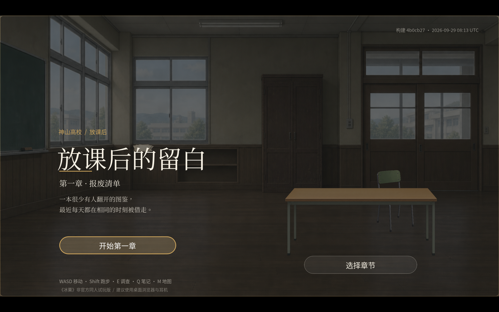

# 《冰菓》同人试玩 · 第一章

由私有仓库 `gongfpp/Iscream` 自动构建部署的 Godot Web 构建产物，只提供第一章「报废清单」的试玩。

<p align="center">
  
</p>

**在线访问：** <https://gongfpp.github.io/Iscream-web/>


## 说明

- 本仓库为可公开的静态运行/构建产物，不包含私有源码、测试与评审素材。
- 仓库未附开源许可，代码、文案与素材未授予额外复用许可；第三方引擎与字体按其自带许可使用；第三方许可见仓库内 `licenses/`。

## 本地运行

静态站点，任意静态服务器即可：

```bash
python3 -m http.server 8080
# 浏览器打开 http://localhost:8080/
```
